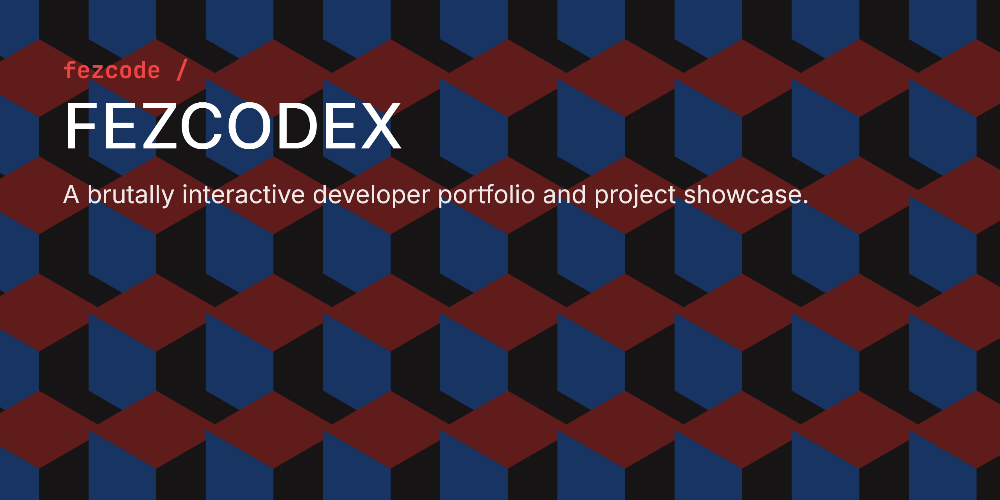

# Fezcodex



### What is this?
Imagine you have a giant digital toy box. Inside, you keep the cool things you've built, the stories you've written, and a diary of all the interesting things you've learned. Fezcodex is that toy box. It is a special website that works like a personal museum on the internet. It is not just a boring page; it has moving parts, secret "Easter eggs," and little mini-apps like a sound mixer and a knowledge graph.

---

## Key Features
- **Digital Garden**: A space where blog posts and "logs" (mini-diaries about books, movies, or games) grow.
- **Knowledge Graph**: A 3D interactive visualization of how all content on the site is interconnected.
- **Project Archives**: A showcase of all the coding experiments and software I've built.
- **Mini-Apps**: Built-in tools like an Atmosphere Mixer, Cloud Music Player, Typing Tester, and a digital Rotary Phone.
- **Visual Magic**: Change how the whole site looks using the "Visual Matrix"—make it look like an old computer (CRT), a blueprint, or even a comic book.
- **Achievements**: Just like a video game, you get little trophies for exploring the site and finding hidden things.

---

## Tech Stack (The Lego Bricks)
- **Frontend**: React 19, Tailwind CSS, and Framer Motion for smooth animations.
- **3D & Graphics**: Three.js and react-force-graph-3d for the knowledge graph.
- **Content**: Markdown and **PIML** (Plain Old Markup Language) for structured content.
- **Build Tools**: Vite + Vike for the SPA build and one HTML shell per route; GitHub Actions builds and deploys to GitHub Pages. An optional Puppeteer crawler can prerender page content (`npm run prod:full`).
- **Persistence**: Local Storage for settings, achievements, and persistent state.

---

## Project Structure
- `src/app/`: Domain logic, core features, and views (Achievements, OS, Command Palette, etc.).
- `src/components/`: Reusable UI components (Buttons, Modals, Cards).
- `src/context/`: Global state management (Visual Settings, Toast, Animation).
- `public/`: The "pantry" where all actual content (PIML files, text, images, sounds) is stored.
- `scripts/`: Helper programs for generating RSS, sitemaps, and wallpapers.

---

## Technical Setup

### Prerequisites
Make sure you have Node.js installed on your computer.

### 1. Get the code
```bash
git clone https://github.com/fezcode/fezcode.github.io.git
cd fezcode.github.io
```

### 2. Install the tools
```bash
npm install
```

### 3. Start the engine
```bash
npm start
```
This will open the site at http://localhost:5190 (the dev server port set in `vite.config.mjs`; if that port is busy, Vite falls back to the next free one — check the terminal output).

---

## Routing and SEO
This project uses `BrowserRouter` for clean URLs. To support this on static hosts like GitHub Pages, the build writes a real `index.html` for every route:

1. **Vite + Vike** produces the JS bundles and writes one empty-shell `index.html` per route listed in `pages/routes.js` plus every dynamic route discovered by `pages/discoverRoutes.js` (blog posts, series episodes, log entries, story book pages, discovery entries, tag pages — ~1,100 routes total). Each shell gets its own title, description and OG image from `scripts/inject-meta.mjs` and `scripts/generate-og-images.mjs`, so link previews work without any further step.
2. **`scripts/prerender-crawl.mjs`** (optional; full builds only) spins up a Vite preview server, loads each shell in headless Chromium, and replaces the empty `#react-root` with the rendered HTML. The browser discards that snapshot and renders fresh once the bundle runs, and the snapshot always shows the default theme, so its only real benefit is text for crawlers that don't run JavaScript. It takes ~7 minutes, so `npm run prod` skips it; use `npm run prod:full` when you want it. Skipped routes fall back to SPA rendering at runtime — not a build failure.

### Build variants
| Command | What it does | When to use |
| --- | --- | --- |
| `npm run build` | Vite build + post-build + full prerender crawl + OG images + meta | What `npm run prod:full` uses. Produces a fully prerendered `dist/client/`. |
| `npm run build:lite` | Pregenerate + Vite build + OG images + per-page meta, no crawl | What `npm run prod` uses. Pages render in the browser; link previews are unchanged. |
| `npm run build:fast` | Vite build + post-build only (no crawl, no OG images or meta) | Fast iteration on components; skip the ~7 min crawler. |
| `npm run build:retry` | Full crawl, then re-attempts any routes that missed the render gate | Use when the default build reports many skipped routes (flaky JS/fetch under load). |

Tune the crawler via env vars: `PRERENDER_CONCURRENCY=6` (default `6`; use `3` if the crawl stalls), `PRERENDER_RETRY=1` (same as `--retry`).

### Deployment
The site is built and published by GitHub Actions (`.github/workflows/deploy.yml`), using the official Pages actions: the repo's Pages source is **GitHub Actions**, not a branch.

```bash
npm run prod             # lint + git push; the push to main builds (build:lite) and deploys on GitHub
npm run prod:full        # the same, plus a second run that includes the prerender crawl
```

- Every push to `main` deploys. Follow a run with `gh run watch` or in the repo's Actions tab.
- **Run workflow** in the Actions tab has two switches: `prerender` (full build with the crawl) and `deploy` (untick to test a build without publishing).
- A newer push cancels a run still in progress. If a build fails, the site keeps serving the last good deploy.

**Rollback (legacy local deploy):** the old `gh-pages` scripts still exist (`npm run deploy`, `deploy:lite`, `deploy:fast`, `deploy:retry`). They push `dist/client` to the `gh-pages` branch, which only goes live if the Pages source is switched back to "Deploy from a branch: gh-pages" in the repo settings.

### Content Syncing
Stories are managed via git subtrees. Because subtree remotes are not tracked by git, you must initialize the remote once after cloning:
- `npm run init-stories`: Initialize the stories remote URL (only needed once).
- `npm run pull-stories`: Sync stories from the remote repository.
- `npm run push-stories`: Push local story changes to the remote repository.

---

## Rules of the House
- **Contributing:** Please read our [CONTRIBUTING.md](CONTRIBUTING.md) for guidelines on commit messages and content updates.
- **Styling**: We use Tailwind. Keep it **Brutalist** yet polished.
- **Components**: Always use `CustomDropdown`, `BrutalistDialog`, and `CustomSlider` for UI consistency.
- **Icons**: We use `@phosphor-icons/react`. Always use the ones ending in `Icon` (e.g., `CpuIcon`).
- **Logic**: Use Context for global settings like Visual Effects and Achievements.

---

## Developer Guide: How to Update Things

If you are modifying or expanding the functionality of Fezcodex, follow these specific architectural patterns:

### 1. Adding or Updating Commands
Commands are used in the **Commands Page** and the **Command Palette**. To update them, you must touch three places:
- **`src/data/commands.js`**: Update the UI data (title, description, icon color) for the `/commands` page.
- **`src/hooks/useCommandRegistry.js`**: Implement the actual logic/handler for what the command does.
- **`src/hooks/useSearchableData.js`**: Update the `customCommands` list so the Command Palette (`Ctrl + K`) can "find" the command.

### 2. Updating Search Data
The site-wide search (Command Palette and Search bar) is powered by a unified registry:
- **Automatic:** Blog posts, Projects, and Logs are automatically indexed from their respective `.json` and `.piml` files in the `public/` directory.
- **Manual:** Static pages and custom commands must be manually added to the `staticRoutes` or `customCommands` lists in `src/hooks/useSearchableData.js`.

### 3. Modifying Visual Themes (Brutalist vs. Luxe)
Every core component should be **Theme-Aware**:
- **Switcher Components:** Components like `CommandPalette.jsx`, `SidePanel.jsx`, and `GenericModal.jsx` act as controllers. They detect `fezcodexTheme` and render either a `BrutalistX` or `LuxeX` variant.
- **Universal Styles:** Prefer the `variant="brutalist"` or `variant="paper"` props for shared components like `CustomDropdown` to maintain consistency.

### 4. Global State & Persistence
- Use `VisualSettingsContext.jsx` for any UI state that needs to survive a page refresh (Invert mode, Theme selection, etc.).
- Use `usePersistentState` hook to automatically sync your context variables with `localStorage`.

### 5. Adding Content
- **Blog posts:** write `public/posts/<slug>.txt` and add an entry at the top of `public/posts/posts.json` (slug, title, date, updated, description, tags, category, filename, authors).
- **Discovery logs:** add an `(item)` to `public/logs/<type>/<type>.piml` and an optional `<slug>.txt` beside it.
- Every post, log and project needs tags; run `npm run generate-tags` afterwards, then `npm run lint`.

---

## Github Pages Configuration

1. Settings → Pages → Source: **GitHub Actions** (the workflow is `.github/workflows/deploy.yml`).
2. Custom domain: `fezcode.com`, with HTTPS enforced.

---

Created by [Ahmed Samil Bulbul](https://fezcode.com).
